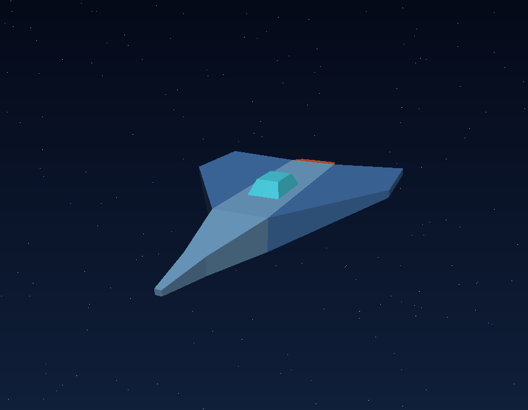

# Lab 4 — Carga y rasterización de un modelo OBJ
## Ejecución

```bash
cargo run --release
```

Controles:

- `←`/`→` o `A`/`D`: rotar horizontalmente.
- `↑`/`↓` o `W`/`S`: rotar verticalmente.
- `+`/`-`: acercar o alejar la cámara.
- `R`: restablecer la cámara.
- `Esc`: cerrar la ventana.

## Estructura

```text
assets/
  Nave.obj              Modelo exportado desde Blender
  Sin_nombre.mtl        Material original del modelo
renders/
  nave_render.png       Resultado incluido en este README
src/
  clipping.rs           Clipping homogéneo contra los seis planos del frustum
  color.rs              Representación y operaciones de color
  framebuffer.rs        Buffer de color, z-buffer y exportación PNG
  math.rs               Vectores, matrices Model/View/Projection y look-at
  model.rs              Parser OBJ propio: vértices, normales, caras e índices
  renderer.rs           Orden y coordinación de las etapas del pipeline
  shaders.rs            Uniforms, varyings, vertex shader y fragment shader
  triangle.rs           Rasterización, interpolación y ejecución por fragmento
  main.rs               Ventana, controles y modo de exportación
```

## Pipeline implementado

1. **Aplicación:** `model.rs` lee posiciones (`v`), normales (`vn`) y caras (`f`).
   Los índices OBJ comienzan en 1 y se convierten a índices de Rust desde 0.
2. **Uniforms:** la aplicación prepara matrices `Model`, `View` y `Projection`,
   además de la cámara, la luz y el tamaño del viewport.
3. **Vertex shader:** transforma cada posición hasta clip space y produce los
   varyings de posición mundial, normal y color.
4. **Primitive assembly:** cada cara `(0, 1, 2, 3)` se divide manualmente en
   `(0, 1, 2)` y `(0, 2, 3)` mediante una triangulación en abanico.
5. **Clipping:** Sutherland–Hodgman recorta cada triángulo contra los planos left,
   right, bottom, top, near y far. Los polígonos resultantes se vuelven a triangular.
6. **Perspective divide y viewport:** clip space pasa a NDC dividiendo entre `w`,
   y luego a coordenadas reales del framebuffer.
7. **Rasterización:** `triangle.rs` usa un bounding box y coordenadas baricéntricas.
   Los varyings se interpolan con corrección de perspectiva para cada fragmento.
8. **Fragment shader y operaciones por fragmento:** calcula iluminación difusa y
   especular por fragmento; el depth test conserva el fragmento visible en el
   z-buffer antes de escribir su color en el framebuffer.

El modelo incluido tiene **44 vértices**, **42 caras** y produce **84 triángulos**.


